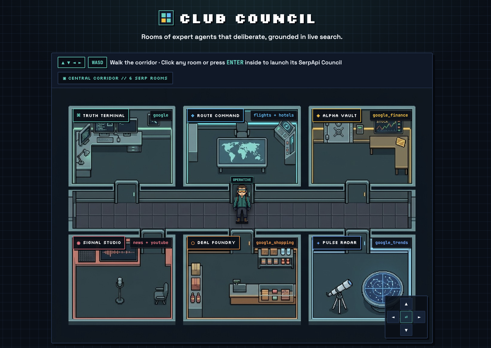
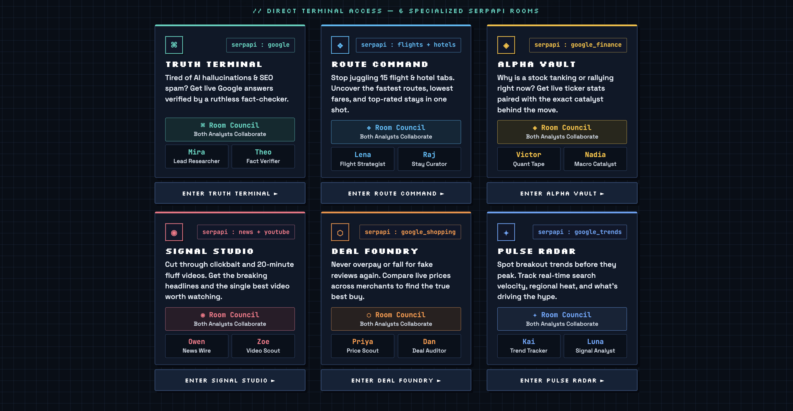

# ▣ Council Room

> Watch the launch video:

https://github.com/user-attachments/assets/980f68f1-2e77-4904-832f-31b910df7f0c

Stop drowning in 20 open tabs. **Council Room** is an interactive, minimalist pixel-art clubhouse of specialized AI rooms powered by **SerpApi** and **Agno Agents**.

Walk your operative around the 6-room floorplan using **Arrow Keys / WASD / On-Screen D-Pad** (or click any room directly) to enter a specialized deliberation room. Inside each room, you can either:
- **Talk to the Full Room Council** — watch both specialist agents query live SerpApi engines in sequence, cross-examine findings, and synthesize a grounded answer with verifiable sources.
- **Talk 1-on-1 with a Specialist** — chat directly with an individual analyst for targeted lookups.



Every live SerpApi call streams into the **Sidebar Search Log**, where you can inspect parameters, view raw compact outputs, or clear entries.

All search is powered by the official [SerpApi Python package](https://github.com/serpapi/serpapi-python) — we use its SerpApi engines (`google`, `google_flights`, `google_hotels`, `google_finance`, `google_news`, `youtube`, `google_shopping`, `google_trends`) via `serpapi.Client().search()`.

---

## 🗺️ The 6 SerpApi Council Rooms



| Room | SerpApi Engine(s) | Council Specialists | What It Solves |
| :--- | :--- | :--- | :--- |
| **⌘ Truth Terminal** | `google` | **Mira** *(Lead Researcher)*<br>**Theo** *(Fact Verifier)* | Tired of AI hallucinations & SEO spam? Get live Google answers verified by a ruthless fact-checker. |
| **❖ Route Command** | `google_flights`<br>`google_hotels` | **Lena** *(Flight Strategist)*<br>**Raj** *(Stay Curator)* | Stop juggling 15 flight & hotel tabs. Uncover the fastest routes, lowest fares, and top-rated stays in one shot. |
| **◈ Alpha Vault** | `google_finance` | **Victor** *(Quant Tape)*<br>**Nadia** *(Macro Catalyst)* | Why is a stock tanking or rallying right now? Get live ticker stats paired with the exact catalyst behind the move. |
| **◉ Signal Studio** | `google_news`<br>`youtube` | **Owen** *(News Wire)*<br>**Zoe** *(Video Scout)* | Cut through clickbait and 20-minute fluff videos. Get the breaking headlines and the single best video worth watching. |
| **⬡ Deal Foundry** | `google_shopping` | **Priya** *(Price Scout)*<br>**Dan** *(Deal Auditor)* | Never overpay or fall for fake reviews again. Compare live prices across merchants to find the true best buy. |
| **✦ Pulse Radar** | `google_trends` | **Kai** *(Trend Tracker)*<br>**Luna** *(Signal Analyst)* | Spot breakout trends before they peak. Track real-time search velocity, regional heat, and what's driving the hype. |

---

## 🎮 Interactive Floorplan Controls

- **Keyboard**: Use `▲ ▼ ◄ ►` or `W A S D` to walk along the central corridor and into any room. Press `Enter` or `Space` when inside a room zone to launch its Council.
- **Mouse / Touch**: Click any room on the floorplan to walk directly to its doorway and enter automatically, or use the on-screen pixel D-Pad (`▲ ◄ ⏎ ► ▼`).
- **Direct Terminal Cards**: Scroll below the floorplan to jump straight into any room via the 3×2 terminal grid.

---

## ⚡ Setup & Installation

Requires Python 3.11+ and [uv](https://docs.astral.sh/uv/).

1. **Clone the repository**:
   ```bash
   git clone https://github.com/lucifertrj/council-room-serp.git
   cd council-room-serp
   ```

2. **Install dependencies**:
   ```bash
   uv sync
   ```

3. **Configure secrets**:
   Copy the template and add your API keys:
   ```bash
   cp .streamlit/secrets.toml.example .streamlit/secrets.toml
   ```
   ```toml
   ANTHROPIC_API_KEY = "your_anthropic_api_key"
   SERPAPI_API_KEY = "your_serpapi_api_key"
   ```
   On Streamlit Community Cloud, paste the same into the app's **Secrets** panel.

4. **Run the app**:
   ```bash
   uv run streamlit run app.py
   ```
---

## 📄 License

MIT — see [LICENSE](LICENSE). Repo: https://github.com/lucifertrj/council-room-serp

## Demo

- Try it now: https://council-room-serp.streamlit.app/
- This is my submission for PyConZA Hackathon